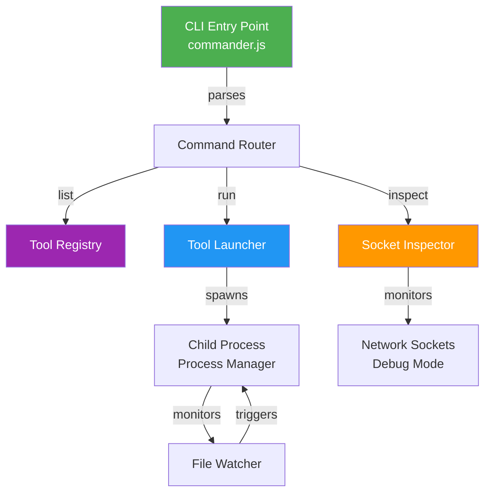
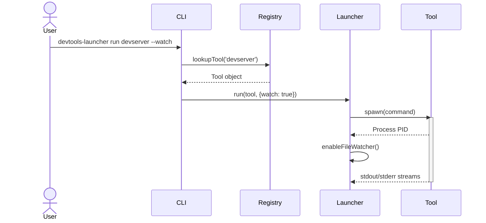

# 🏗️ Architecture — devtools-launcher

## System Overview



## Core Components

### 1. **CLI Entry Point** (`cli.ts`)
- Uses `commander.js` for argument parsing
- Routes commands to appropriate handlers
- Provides user-friendly output with `chalk` colors

### 2. **Tool Registry** (`launcher.ts` → `registerDefaultTools()`)
- In-memory Map of registered tools
- Each tool: `name`, `description`, `command`, optional `port`
- Extensible for custom tool registration

### 3. **Tool Launcher** (`launcher.ts` → `run()`)
- Spawns child processes for registered tools
- Optional `--watch` flag enables file watching
- Supports custom port configuration

### 4. **Socket Inspector** (`launcher.ts` → `inspectSocket()`)
- Monitors open connections on specified port
- Useful for debugging active dev servers
- Cross-platform socket inspection

## Data Flow



## Type System

```typescript
// Core types
interface Tool {
  name: string;
  description: string;
  command: string;
  port?: number;
}

interface LaunchOptions {
  port?: number;
  watch?: boolean;
}
```

## Testing Strategy

- **Unit Tests:** Tool registry, launch logic, socket inspection
- **Integration Tests:** CLI commands with real spawning
- **Coverage Target:** 80%+ statements/branches/lines

## Deployment & Distribution

- Built for **npm**: `npm install -g devtools-launcher`
- Binary entry point via `package.json` bin field
- TypeScript compiled to CommonJS (`dist/`)
- Source maps for debugging

## Future Enhancements

- [ ] Configuration file support (`.devtools.yml`)
- [ ] Custom plugin loader
- [ ] Shell integration (bash/zsh completion)
- [ ] GUI dashboard for tool management
